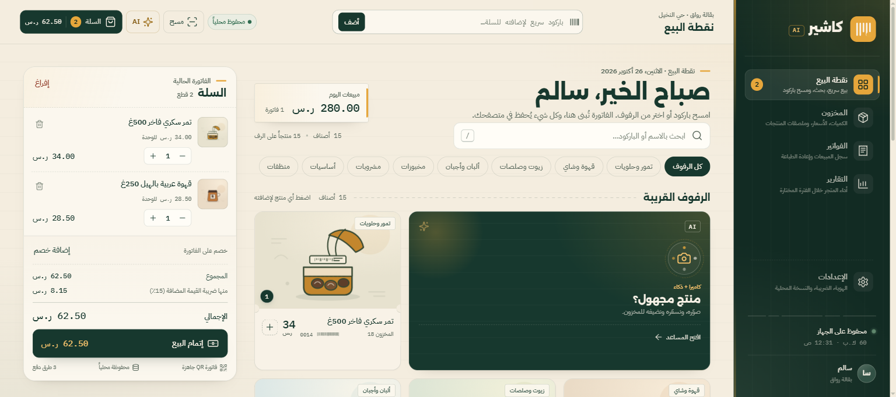
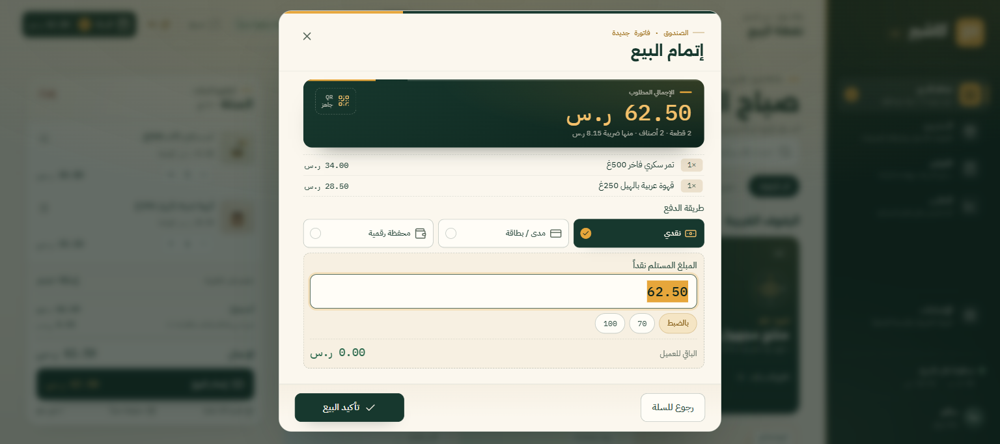
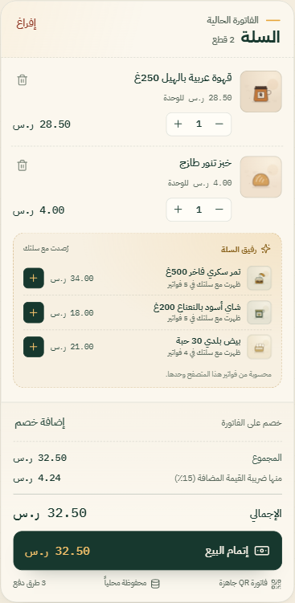
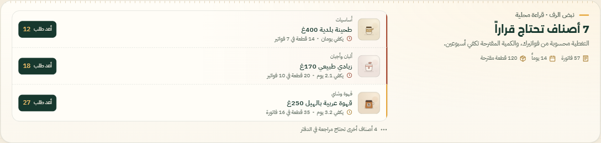
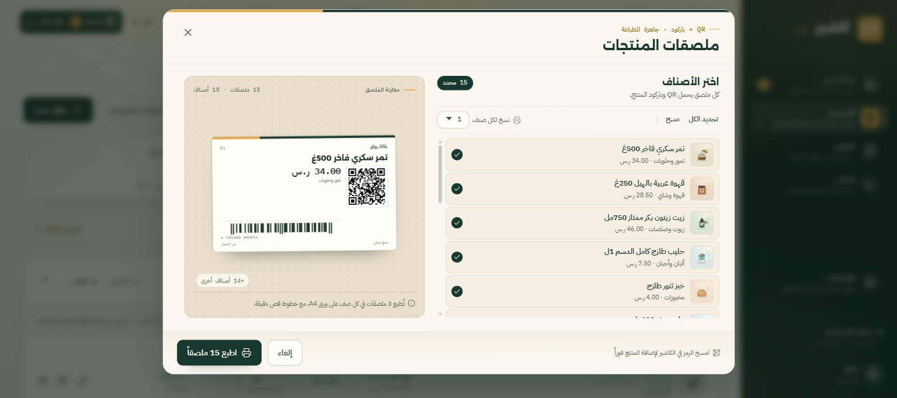
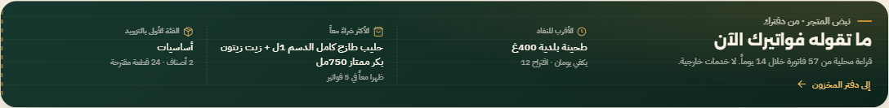
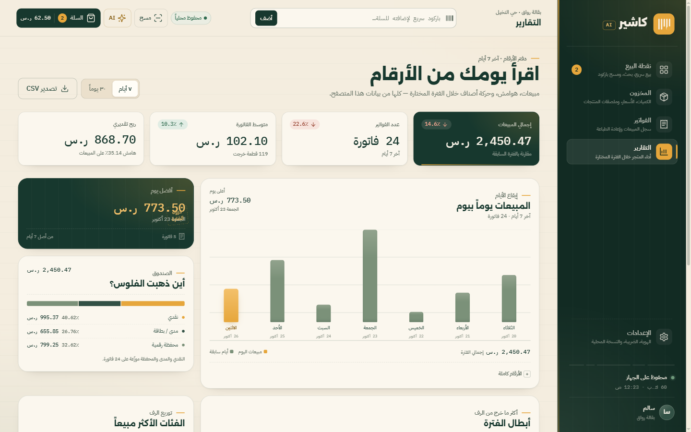

# كاشير AI

نقطة بيع عربية (RTL) للبقالات تعمل محليًا داخل المتصفح: مسح باركود بالكاميرا، سلة ودفع، تعرّف على المنتجات من صورة، فواتير وملصقات QR، مخزون، وتقارير. لا تحتاج إلى خادم أو حساب — كل البيانات تُحفظ في `localStorage` على جهازك.



## المزايا

- **نقطة بيع كاملة:** بحث وتصنيفات، إضافة سريعة، تعديل كميات، خصم بالنسبة أو المبلغ، ضريبة 15% مضمّنة افتراضيًا، وثلاث طرق دفع (نقدي، مدى/بطاقة، محفظة رقمية).
- **مسح متعدد المصادر:** كاميرا الجهاز، رفع صورة، أو إدخال الباركود يدويًا. يدعم EAN-13، EAN-8، UPC-A/E، Code 128/39/93، ITF، وQR المنتجات.
- **مساعد بصري هجين:** وضع عرض فوري بلا مفتاح، أو تعرّف حقيقي عبر Gemini عند إضافة مفتاح API. النتيجة مسودة قابلة للتعديل قبل الحفظ.
- **ملصقات وفواتير:** ملصقات منتجات EAN-13 حقيقية مع QR، معاينة حية، وطباعة A4؛ وكل فاتورة لها رقم وQR وسجل قابل لإعادة الطباعة.
- **مخزون وتقارير:** إضافة وتعديل وحذف، تعديل كميات، تنبيه انخفاض المخزون، وتقارير 7/30 يومًا مع تصدير CSV.
- **ذاكرة المتجر:** يقرأ التطبيق فواتيرك المحلية ليقترح إعادة التزويد في «نبض الرف»، ويقترح أصنافًا تُشترى مع سلتك في «رفيق السلة»، ويلخّص أسرع صنف نفادًا وأكثر الأصناف شراءً معًا في «نبض المتجر». الحساب محلي بالكامل، ويتحول إلى حالة تعلّم صريحة عند قلة الفواتير.
- **نسخ احتياطي محلي:** تصدير واستيراد JSON واستعادة بيانات العرض. مفتاح Gemini لا يُضمَّن أبدًا في ملف التصدير.

## المتطلبات

- **Node.js 18 أو أحدث** (اختُبر على Node 24) لتشغيل الخادم المحلي والاختبارات فقط.
- **متصفح حديث:** Chrome أو Edge موصى بهما، خاصة للكاميرا والطباعة.
- **كاميرا ومنفذ آمن للكاميرا:** تعمل الكاميرا عبر `localhost` أو HTTPS بعد منح إذن المتصفح. رفع الصورة بديل متاح دائمًا.
- لا حاجة إلى مفتاح Gemini للتشغيل؛ الوضع التجريبي يعمل مباشرة.

## التثبيت والتشغيل

المشروع بلا اعتماديات خارجية وبلا خطوة بناء، لذلك لا تحتاج إلى `npm install`.

```bash
cd path/to/cashier-ai
npm start
```

ثم افتح:

```
http://localhost:4173
```

لتغيير المنفذ:

```bash
PORT=8080 npm start
```

في PowerShell على Windows:

```powershell
$env:PORT=8080; npm start
```

> لا تفتح `index.html` بنقرة مزدوجة. تشغيل المشروع عبر خادم ضروري لعمل وحدات JavaScript، ولن تعمل الكاميرا من مسار `file://`.

### خادم بديل أو استضافة

المشروع ملفات ثابتة فقط، ويمكن تقديمه بأي خادم ملفات. التوجيه يعتمد على `#hash`، لذلك لا يحتاج إلى قواعد إعادة كتابة. عند الاستضافة على نطاق خارجي استخدم HTTPS كي تعمل الكاميرا.

### الاختبارات

```bash
npm test
```

يشغّل هذا الأمر اختبارات Node المدمجة لمنطق البيع، والتحقق من EAN-13، وتحليلات ذاكرة المتجر، والتخزين والاستيراد/التصدير.

## الاستخدام

عند أول تشغيل تُحمّل بيانات متجر عرض «بقالة رواق» (منتجات وفواتير) لتجربة التطبيق مباشرة. أي تغيير يُحفظ تلقائيًا في المتصفح.

### نقطة البيع

1. أضف صنفًا بالنقر على بطاقته، أو ابحث عنه، أو اكتب باركوده في حقل «باركود سريع» أعلى الصفحة.
2. عدّل الكميات من السلة، واحذف الأصناف، وطبّق خصمًا إن لزم.
3. اضغط «إتمام البيع»، اختر طريقة الدفع، وأدخل المبلغ المستلم عند الدفع النقدي (يجب ألا يقل عن الإجمالي).
4. بعد التأكيد تُنشأ الفاتورة، تُخصم الكميات من المخزون، ويمكنك طباعتها أو فتحها لاحقًا من أرشيف الفواتير.



**رفيق السلة:** عندما تحتوي السلة على أصناف، تظهر أسفلها اقتراحات مبنية على ما ظهر معها في فواتيرك السابقة، مع عدد الفواتير الداعمة لكل اقتراح. إذا لم تتوفر أزواج متكررة كافية، يقترح الأكثر مبيعًا في الفئة نفسها. لا تظهر الأصناف الموجودة في السلة أو النافدة، والنقر على الاقتراح يضيفه مباشرة. عند قلة الفواتير تظهر رسالة بأن الاقتراحات ستتحسن مع البيع بدلًا من أرقام غير موثوقة.



### مسح الباركود

- اضغط زر «مسح» أو **F2** لفتح الكاميرا، ثم وجّهها إلى الباركود. يستخدم التطبيق `BarcodeDetector` عند توفّره، وإلا يعتمد على ZXing المرفق محليًا.
- يمكنك رفع صورة باركود بدلًا من الكاميرا من نافذة المسح.
- إذا كان الباركود غير مسجّل، يُفتح نموذج منتج جديد بالباركود مُعبأً مسبقًا، ويمكنك الحفظ مع إضافته للسلة مباشرة.
- ملصقات المنتجات التي يطبعها التطبيق تحمل QR يمكن مسحه لإضافة المنتج. QR الفاتورة مخصّص للسجل والتحقق ولا يُضاف كمنتج.

### المساعد البصري AI

1. اضغط زر **AI** أو **F3**.
2. التقط صورة للمنتج أو ارفع صورة من الجهاز.
3. بلا مفتاح Gemini: يعمل **وضع العرض** ويقترح منتجًا بناءً على ألوان الصورة وصفتها، مع وسم واضح بأنه ليس تعرّفًا حقيقيًا.
4. مع مفتاح Gemini: تُرسل الصورة إلى Google ويُعاد اقتراح بالاسم والتصنيف والسعر والكمية.
5. راجع الحقول وعدّلها، ثم احفظ المنتج في المخزون أو اختر «احفظ وأضف للسلة».

### المخزون والملصقات

- من **المخزون** أضف منتجًا أو عدّل بياناته أو احذفه، وحدّث الكميات بأزرار النقص والزيادة.
- **نبض الرف:** يقرأ أعلى الصفحة حركة البيع في آخر 14 يومًا، ويعرض سرعة البيع والتغطية المتوقعة لكل صنف. الأصناف النافدة أو القريبة من النفاد تظهر أولًا مع كمية إعادة تزويد مقترحة وزر تأكيد يضيفها إلى الرصيد الحالي بعد مراجعة الفرق. إذا كانت الفواتير أقل من ثلاث، يعرض التنبيه حالة تعلّم صريحة بدلًا من توصيات مضللة.



- صور المنتجات وبياناتها تُحفظ محليًا؛ حذف منتج لا يغيّر الفواتير السابقة.
- لطباعة الملصقات: افتح «ملصقات المنتجات»، حدّد الأصناف وعدد النسخ لكل صنف (1–6)، راجع المعاينة، ثم اطبع. تُرتب الملصقات ثلاثة في الصف على ورق A4، ويحمل كل ملصق الاسم والسعر وQR وEAN-13.



عند الطباعة من نافذة المتصفح اختر A4، ومقياس 100%، وفعّل «رسومات الخلفية / Background graphics» للحصول على ألوان الملصق والفاتورة الصحيحة.

### الفواتير والتقارير

- **الفواتير:** ابحث برقم الفاتورة أو الكاشير، صفِّ حسب طريقة الدفع، افتح الفاتورة لعرض QR وبياناتها، أو أعد طباعتها.
- **التقارير:** بدّل بين 7 و30 يومًا لعرض الإيرادات وعدد الفواتير ومتوسط السلة والمنتجات الأكثر بيعًا، ثم صدّر CSV يفتح في Excel مع ترميز عربي سليم.
- **نبض المتجر:** شريط أعلى التقارير يلخّص الأقرب للنفاد، الأكثر شراءً معًا، والفئة الأولى بالتزويد، مع رابط سريع إلى المخزون. تعتمد القراءة على نافذة 14 يومًا مستقلة عن مدة التقرير وتذكرها صراحة.





### الإعدادات

- هوية المتجر والفرع والكاشير والهاتف.
- رمز العملة وكودها ونسبة الضريبة، وخيار «الأسعار تشمل الضريبة».
- أصوات الصندوق.
- مفتاح Gemini والطراز واختبار الاتصال.

## إعداد Gemini (اختياري)

1. احصل على مفتاح API من [Google AI Studio](https://aistudio.google.com/app/apikey).
2. افتح **الإعدادات ← مساعد المنتجات الذكي**.
3. الصق المفتاح، اختر الطراز (`gemini-2.5-flash` افتراضيًا، أو Pro/2.0 Flash)، ثم اضغط «اختبر الاتصال».
4. احفظ الإعدادات. عند التصوير تُرسل الصورة مباشرة من متصفحك إلى Google.

> **ملاحظة أمنية:** يُحفظ المفتاح كنص في `localStorage` على هذا الجهاز، ويُستدعى من المتصفح مباشرة. هذا مناسب للتجربة الشخصية فقط. لا تشارك الجهاز مع من لا تثق به، ولا تضع المفتاح في المستودع. لاستخدام إنتاجي ضع خادمًا وسيطًا يحمي المفتاح. ملفات النسخ الاحتياطي تحذف المفتاح تلقائيًا.

## البيانات والنسخ الاحتياطي والخصوصية

- مفتاح التخزين: `cashier-ai:v1` في `localStorage`.
- البيانات مرتبطة بالمتصفح والعنوان نفسه (بما في ذلك المنفذ)؛ لا مزامنة بين الأجهزة أو المتصفحات، وتغيير المنفذ يعني مساحة بيانات مختلفة.
- السعة المتاحة عادة نحو 5 م.ب. قد تستهلك صور المنتجات معظمها. عند تعذّر الحفظ يظهر تنبيه، لذا صدّر نسخة دوريًا.
- **صدّر نسخة** ينتج ملف JSON بكل المنتجات والفواتير والسلة والإعدادات، منزوعًا منه مفتاح Gemini. **استورد نسخة** يستبدل البيانات الحالية، ويُبقي مفتاح Gemini والطراز المحليين. الحد الأقصى لملف الاستيراد 8 م.ب.
- **استعد البيانات التجريبية** يعيد منتجات وفواتير العرض فقط، ويُبقي مفتاح Gemini وطرازه.
- مسح بيانات الموقع من إعدادات المتصفح يحذف كل شيء. قد لا يستمر الحفظ في وضع التصفح الخاص بعد إغلاق النافذة.
- لا توجد تحليلات أو حسابات أو طلبات خارجية عدا استدعاء Gemini عند استخدام مفتاح. الخطوط ومكتبات QR والمسح محلية، وتحليلات «ذاكرة المتجر» تُحسب في المتصفح من الفواتير المحلية فقط.

## اختصارات لوحة المفاتيح

| الاختصار | الإجراء |
| --- | --- |
| `/` | الانتقال إلى حقل البحث في الصفحة الحالية |
| `F2` | فتح كاميرا مسح الباركود |
| `F3` | فتح المساعد البصري AI |
| `Esc` | إغلاق النافذة أو سلة الجوال |

تعمل الاختصارات خارج حقول الكتابة.

## هيكل المشروع

```
index.html               نقطة الدخول
assets/css/              التنسيقات: الأساس، الهيكل، الصفحات، النوافذ، الطباعة
assets/js/               منطق التطبيق، المتجر، المسح، AI، الطباعة، والعروض
assets/fonts/            Alexandria وIBM Plex Sans Arabic وIBM Plex Mono محليًا
assets/vendor/           qrcode-generator وZXing مع رخصهما
scripts/serve.mjs        خادم ملفات محلي
tests/                   اختبارات node:test
docs/screenshots/        لقطات التوثيق
```

## حدود الاستخدام

هذا التطبيق أداة محلية لجهاز واحد ومتصفح واحد: لا يتضمن تسجيل دخول أو صلاحيات، ولا مزامنة سحابية، ولا معالجة دفع حقيقية. الدفع يُسجَّل في الفاتورة فقط. كما لا يقدّم فوترة إلكترونية متوافقة مع ZATCA؛ يلزم تكامل منفصل لذلك عند الاستخدام التجاري.

اقتراحات «ذاكرة المتجر» إرشادية وتتأثر بجودة سجل الفواتير على هذا الجهاز وحده؛ هي مساعدة لاتخاذ القرار وليست تنبؤًا مؤكدًا بالمبيعات أو بديلًا عن الجرد الفعلي.

## رخص الطرف الثالث

- [qrcode-generator](https://github.com/kazuhikoarase/qrcode-generator) — MIT، الرخصة في `assets/vendor/LICENSE-qrcode.txt`.
- [ZXing](https://github.com/zxing-js/library) — Apache License 2.0، الرخصة في `assets/vendor/LICENSE-zxing.txt`.
- خطوط Alexandria وIBM Plex — SIL Open Font License 1.1، نصها في `assets/fonts/OFL.txt`.
